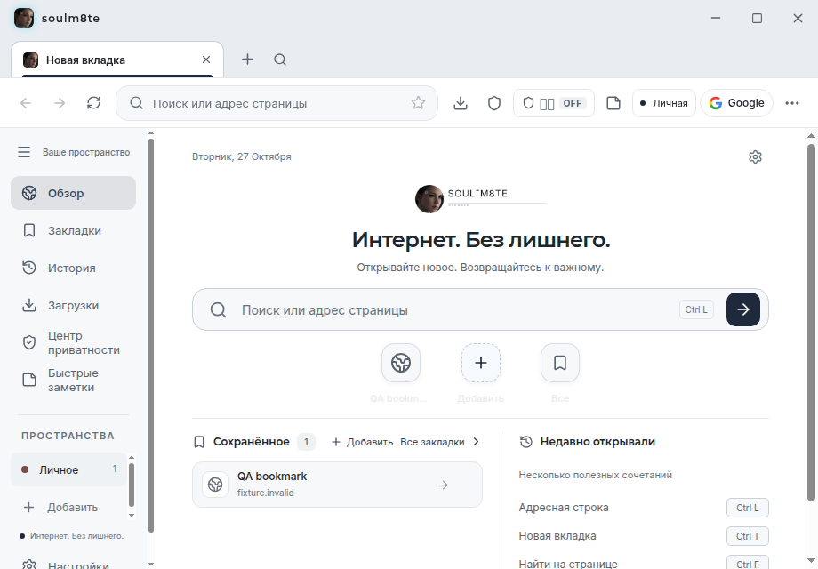
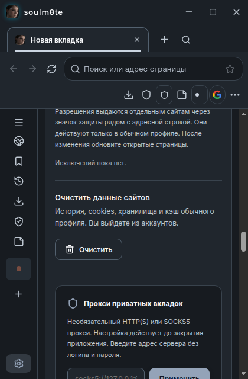
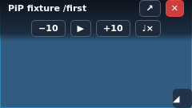

# Аудит SOUL-M8TE / MonkeyBuissnesBrowser — 27 октября 2026

Исходная версия: `c741fbe` (ветка `main`). Во время работы интегрирован пользовательский визуальный мини-патч `b0e602a`: границы страницы до нижнего края окна, устранение зазора и отображение обоев только на внутренних страницах/панелях. Проверка кода, локальные страницы в настоящем Electron, регрессионные тесты и снимки интерфейса. Пять отдельных направлений: ядро браузера, память, full stack/UI, архитектура и безопасность, тестирование. Это проверка воспроизводимых сценариев, а не гарантия отсутствия всех ошибок на любых сайтах.

## Найденные проблемы и исправления

| Область | Причина / наблюдение | Исправление |
|---|---|---|
| Меню и диалоги | Пересчёт размеров поднимал native WebContentsView поверх оболочки | Состояние открытого overlay сохраняется; порядок слоёв восстанавливается после resize и переключения вкладок |
| Режим чтения | Extractor вызывался в мире сайта вместо isolated preload, статья не извлекалась; закрытие диалога возвращало native страницу поверх статьи | Extractor выполняется в isolated world 999; учитывается состояние Reader при восстановлении слоёв и фокуса; переход по ссылке не включает Reader повторно |
| HTML статьи | В оболочку попадала внешняя разметка без строгого списка разрешённых элементов и атрибутов | Очистка в renderer: удаляются активные элементы, CSS, обработчики, опасные URL; ссылки направляются через API навигации вкладки |
| Сон вкладок | Отсчёт простоя начинался при открытии, а не при уходе долго читаемой страницы в фон | Время бездействия обновляется при переходе active → background |
| PiP и авторизация | Тихое PiP-видео и opener нативного окна могли выгружаться | Исключения для PiP и активных popup-связей |
| Восстановление сессии | Лениво восстановленная вкладка регистрировалась как загружающаяся | MemoryManager получает фактическое состояние вкладки |
| Завершение работы | Процессы загрузки yt-dlp и внутренние карты оставались активными | Остановка дочерних процессов, очистка состояния; приватные загрузки прекращаются вместе с приватной сессией |
| Динамические сайты | Полный обход DOM при частых мутациях и ненужных нажатиях клавиш | Объединение проверок видео с задержкой 250 мс и ранняя фильтрация клавиш |
| Несохранённые формы | Не учитывались select/change и открытый Shadow DOM | Расширена защита от выгрузки с потерей ввода |
| Заметки | Поздний autosave менял выбранную заметку, мог восстановить удалённую или отменить закрепление | Очередь операций, объединение черновиков, отмена записи удалённого объекта, защита от устаревших ответов |
| Панель вкладок | Вложенные кнопки mute, чрезмерное сжатие и устаревшее оптимистическое выделение | Независимые кнопки, читаемые минимальные размеры, прокрутка, обработка отклонённой активации |
| Узкие окна | Поздний CSS override менял content-area на relative: страница выходила за края, фокус прокручивал даже chrome; панели также не помещались | Компактное расположение и ограничение размеров; замер фактической ширины заметок для native viewport |
| Favicon | Автоматический запрос Google раскрывал имя сайта третьей стороне; ошибка изображения сохранялась при смене URL | Локальная запасная иконка, сброс ошибки для нового источника |
| Диспетчер задач | Медленные запросы метрик могли перекрываться | Только один незавершённый запрос на цикл |
| Горячие клавиши | F11 открывал DevTools | F11 — полноэкранное окно, F12 / Ctrl+Shift+I — DevTools |
| Новая вкладка | Сохранялись старые loading/audio/error/favicon состояния | Сброс состояния при переходе на внутреннюю новую вкладку |
| IPC PiP | Недостаточная проверка источника активации вкладки | Проверка доверенного WebContents, главного frame и принадлежности tab id |

## Дополнительное улучшение PiP

По дополнительному запросу добавлены: перемещение за заголовок, изменение размера за угол с сохранением пропорций, запоминание позиции и размера в текущем запуске, пауза/воспроизведение, mute, ±10 секунд для конечного видео, возврат к вкладке и закрытие. Один активный плеер, проверка наличия видео, защита от закрытия при переходе из native PiP в mini, проверка отправителя IPC изменения размеров. Неудачный запуск отображает понятное сообщение.

## Что уже есть и что развивать дальше

Уже реализованы: реальные вкладки Chromium, история, закладки, загрузки, поиск по странице и вкладкам, приватные сессии, восстановление закрытых вкладок, диспетчер задач, сон вкладок, импорт, локальный менеджер паролей, рабочие пространства, заметки, Reader и PiP. Их наличие не означает полную совместимость Chrome.

| Приоритет | Недостающая возможность | Следующий самостоятельный этап |
|---|---|---|
| Высокий | Подписанные автоматические обновления | Подпись установщиков, публикация релизов, проверяемые метаданные и безопасная доставка обновлений |
| Высокий | Обновляемые рекламные фильтры | Загрузка и проверка EasyList/EasyPrivacy, кеш, откат и тесты совместимости сайтов |
| Средний | Папки закладок и более ёмкое хранилище | Сейчас импорт сохраняет плоскую коллекцию и ограничен действующей моделью хранения |
| Средний | Синхронизация между устройствами | Сервер, аутентификация, шифрование, разрешение конфликтов; не имитация статуса «синхронизировано» |
| Средний | Полноценная экосистема расширений | Сейчас распакованные каталоги и подмножество API Electron; Chrome Web Store не поддержан полностью |
| Отдельный продуктовый этап | Системный VPN | Импорт WireGuard не создаёт туннель. Нужен системный компонент, маршрутизация, DNS и реальные сетевые проверки |

Эти возможности не добавлялись фиктивными кнопками. Подробные ограничения: [PLATFORM_FEATURE_STATUS.md](PLATFORM_FEATURE_STATUS.md).

## Проверки интерфейса

1. Новая вкладка, светлая тема, 920×640: панель браузера и содержимое размещаются в своих областях.
2. Настройки, тёмная тема, 420×640: компактный toolbar, собственная прокрутка настроек; chrome остаётся на месте.
3. Поиск вкладок, ширины 360/680/768/800/1280/1920: диалог находится в окне; допустимый минимум приложения — 360 px.
4. Тридцать вкладок при ширине 800: доступны горизонтальная прокрутка и отдельные кнопки управления; кнопки не вложены друг в друга.
5. Reader на локальной статье: извлечение текста и переход по ссылке проверяются настоящим Electron.
6. Заметки: переключение, закрепление, закрытие с последним черновиком и удаление до autosave проверяются через UI.

## Результаты проверки

| Проверка | Результат |
|---|---|
| `npm run check` | 25 файлов, 231 unit-тест; typecheck и проверка release assets прошли |
| `npm run build` | Main/preload и renderer собраны |
| Electron integration | 17 сценарных скриптов прошли последовательно после объединения мини-патча и PiP |
| `npm audit --omit=dev` | Известных уязвимостей рабочих зависимостей не обнаружено на момент проверки |
| Освобождение ресурсов | Шесть локальных страниц выгружены: native WebContents 6 → 0, процессов 10 → 4; метаданные вкладок сохранены |
| Память в байтах | RSS недоступен в пространстве PID среды; процент экономии RAM не рассчитывается |

Сценарии Electron: навигация/загрузки/приватность; вход и импорт на fixtures; уведомления; cookies YouTube на fixtures; popup; поиск вкладок; история/закладки; пароли; адаптивный UI; media download; обои; бюджет восстановления сессии; горячие клавиши/диспетчер задач; безопасность Reader и переходы; гонки заметок; освобождение страниц; управление PiP на синтетическом VP8-видео.

## Снимки проверенного интерфейса

Новая вкладка, 920 px:

Настройки, 420 px: панель браузера и боковые иконки остаются доступными.

PiP на синтетическом тестовом видео: отдельные элементы управления без перекрытий.

После последнего исправления перекрытия кнопок PiP повторно прошли TypeScript и полный PiP smoke, включая восстановление исходных controls видео при возврате к вкладке.

## Границы проверки

- Внешний вход Google/YouTube не менялся и не проверялся через настоящий аккаунт пользователя.
- Приватность проверяется на локальных fixtures; полная сетевая анонимность не заявляется.
- Headless Linux не подтверждает работу нативного fullscreen, оконного менеджера, системного keyring, установки DEB/AppImage и Windows/macOS.
- Очистка Reader намеренно упрощает сложную разметку; HTTP(S)-изображения статьи разрешены.
- Объединение DOM-проверок и выгрузка вкладок улучшают механизмы экономии ресурсов; универсальный процент экономии RAM не заявляется.
- CI сохраняет доступные снимки проверок в артефакт `browser-ui-evidence`.
