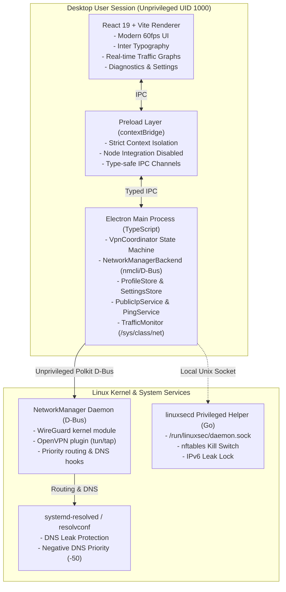
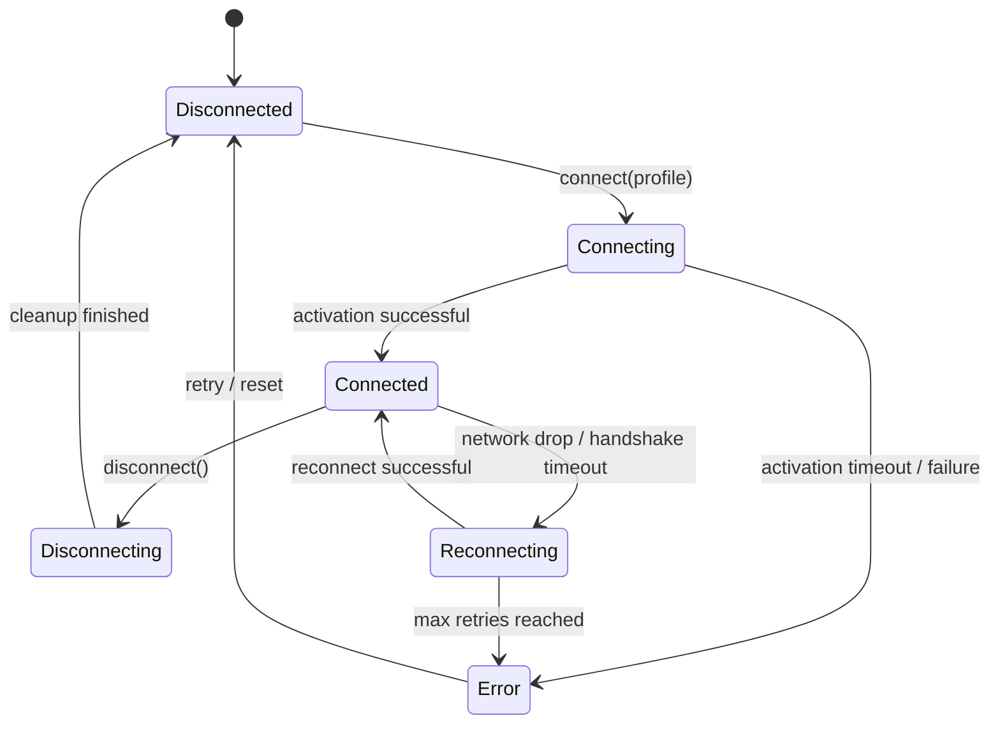

# Linuxsec Architecture & System Design

## 1. High-Level Architectural Overview

Linuxsec is an open, native VPN client engineered specifically for Linux desktop environments (Ubuntu, Debian, Linux Mint, Fedora, Arch Linux). It provides full-system VPN protection across WireGuard and OpenVPN protocols without requiring mandatory user registration, subscriptions, or proprietary accounts.

---

## 2. Principle of Least Privilege (Non-Root GUI)

**Critical Security Rule**: The Electron application and Chromium rendering engine **never** run as `root` (UID 0). Running web browsers or Electron as root introduces severe privilege escalation risks.

Linuxsec achieves complete system networking capabilities through two complementary unprivileged/privileged layers:

1. **NetworkManager Native D-Bus Engine**:
   - Modern Linux desktop sessions grant active local desktop users authorization via PolicyKit (`org.freedesktop.NetworkManager.settings.modify.own` and `modify.system`) to create, activate, and tear down VPN connections.
   - Linuxsec creates clean `lsec_<hash>` connections via `nmcli` / D-Bus.
   - WireGuard private keys and tunnel settings are managed directly by NetworkManager.
   - Tunnels operate at the Linux kernel level, routing all system network traffic.

2. **Privileged Helper Daemon (`linuxsecd`)**:
   - A minimalist, hardened Go daemon running as a systemd service (`linuxsecd.service`).
   - Listens on `/run/linuxsec/daemon.sock` with strict permissions.
   - Performs operations requiring explicit kernel firewall capabilities:
     - Applying `nftables` / `iptables` rules for the system-wide **Kill Switch**.
     - Locking down IPv6 leaks via `net.ipv6.conf.all.disable_ipv6`.
     - Flushes rules cleanly on shutdown or connection restore.

---

## 3. Finite State Machine (VpnCoordinator)

The tunnel lifecycle is managed by an explicit finite state machine with strict transition rules:

### State Definitions:
- `disconnected`: No active tunnel. Normal default system routing and firewall.
- `connecting`: Configuration imported, routes and DNS priority prepared, activation in progress.
- `connected`: Tunnel active in kernel, real-time traffic monitoring started, external IP confirmed.
- `disconnecting`: Graceful teardown: firewall unlocked, interface deactivated, temporary connections purged.
- `reconnecting`: Automatic recovery triggered with exponential backoff (up to 3 attempts).
- `error`: Diagnostic error captured, network restored safely.

---

## 4. Leak Prevention Mechanisms

### 4.1 DNS Leak Protection
- When a profile is activated, Linuxsec configures NetworkManager with `ipv4.dns-priority -50`. In `systemd-resolved`, negative metric priorities assign strict absolute precedence to the VPN interface's DNS servers.
- Queries for all domains bypass local ISP resolvers and route through the VPN tunnel.
- Custom DNS presets (Cloudflare 1.1.1.1, Quad9 9.9.9.9, AdGuard 94.140.14.14) can be enforced across all connections.

### 4.2 IPv6 Leak Protection
- If the VPN endpoint provides only IPv4 transit, unencrypted IPv6 traffic could bypass the tunnel.
- Linuxsec sets `ipv6.method disabled` on the interface and signals `linuxsecd` to drop outgoing IPv6 or disable IPv6 autoconfiguration for the duration of the session.

### 4.3 Kill Switch (Firewall Isolation)
- Implemented with `nftables` (with transparent `iptables` fallback).
- Policy on the `output` chain is set to `drop`.
- Exceptions allowed:
  1. Loopback interface (`lo`).
  2. Established and related connections (`ct state established,related`).
  3. DHCP traffic (`udp dport 67:68`).
  4. Encrypted packets to the VPN server's remote endpoint IP.
  5. Traffic traversing the VPN tunnel interface (`oifname "lsec_*"` or `wg*` / `tun*`).
- If the tunnel drops unexpectedly, non-VPN packets are dropped at the packet filter level, eliminating raw data leaks.

---

## 5. Security Validation & Directive Filtering

Imported `.conf` (WireGuard) and `.ovpn` (OpenVPN) configurations are strictly parsed:
- **WireGuard**: Commands and hooks (`PreUp`, `PostUp`, `PreDown`, `PostDown`, `Table`, `FwMark`) are strictly rejected.
- **OpenVPN**: External script execution directives (`up`, `down`, `route-up`, `client-connect`, `script-security`, `plugin`) are immediately rejected.
- Private keys and credentials are stored with `0600` POSIX file permissions and encrypted via `safeStorage` where supported.
